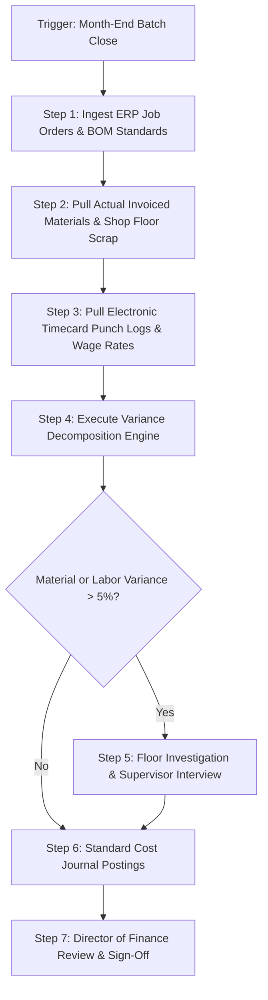

# 📘 Intandem Financial Analyst (Cost Accountant) — Real-World Job Mastery Blueprint

**Target Role**: Financial Analyst – Cost Accountant  
**Organization**: Intandem (NYSARC Chapter Affiliate) — Olean, NY  
**Reporting To**: Director of Finance  
**Classification**: Full-Time, Non-exempt, Days (On-Site) | **Compensation**: $30.75 – $32.25/hr  
**Target Candidate**: Bhupesh Chandra | Intermediate/Experienced Financial Analyst  

---

## 🧭 1. ROLE INPUTS & OPERATIONAL CONTEXT

| Dimension | Specification |
|---|---|
| **Industry & Mission** | Non-profit human services (NYS OPWDD / NYSARC affiliate) providing vocational, residential, and community programs for individuals with intellectual and developmental disabilities. |
| **Operational Setting** | Commercial subcontract manufacturing lines (assembly, kitting/packaging, woodshop/pallets, fulfillment) operating alongside day habilitation and vocational rehabilitation. |
| **Primary Regulatory Drivers** | New York State Consolidated Fiscal Reporting (CFR), OPWDD rate-setting, Medicaid fee-for-service / managed care billing, Uniform Guidance (2 CFR 200). |
| **Tools & Systems** | ERP / General Ledger (e.g., NetSuite, Blackbaud, or Great Plains), timecard/punch systems, Excel (Advanced), State CFR software. |
| **Your Baseline** | 6+ years in FP&A, variance decomposition, SQL, Python, financial modeling, advanced Excel. |

---

## 🗺️ PHASE 1: THE JOB INTELLIGENCE MAP

We analyze every responsibility extracted from the job description across the 10 critical dimensions:

```
[Responsibility 1: Production Cost Accounting] ──► TIER 1 (Critical)
[Responsibility 2: Reimbursement & Revenue Maximization] ──► TIER 1 (Critical)
[Responsibility 3: Annual Budget Formulation & Administration] ──► TIER 1 (Critical)
[Responsibility 4: Routine Accounting & General Ledger Reconciliations] ──► TIER 2 (Important)
[Responsibility 5: Operational Financial Reporting & Executive Advisory] ──► TIER 2 (Important)
```

---

### Responsibility 1: Production-Related Cost Accounting & Variance Analysis (TIER 1 — CRITICAL)
1. **Plain English**: Calculating what it truly costs to make items on Intandem's commercial workshop lines (materials, direct labor, overhead) and analyzing why actual monthly costs differed from standard targets.
2. **Business Purpose**: Ensures Intandem prices commercial subcontract bids competitively without losing money, identifies waste/scrap on the floor, and ensures participant support is properly classified as a reimbursable vocational habilitation expense rather than an operational defect.
3. **Trigger & Frequency**: Triggered weekly by production batch completions and monthly during financial close.
4. **Inputs & Systems**: Shop-floor job routers, raw material vendor invoices, physical inventory counts, electronic punch/timecard records, ERP job-order cost tables.
5. **Exact Steps**:
   - Verify job order closing in ERP.
   - Aggregate actual material issues vs. standard Bill of Materials (BOM).
   - Pull actual logged direct labor hours and multiply by standard/actual labor rates.
   - Apply predetermined manufacturing overhead rate based on machine/labor hours.
   - Calculate Price, Quantity, Labor Rate, and Labor Efficiency variances.
   - Reconcile Work-in-Progress (WIP) and Finished Goods inventory accounts.
6. **Output & Definition of Done**: Monthly Production Variance Schedule reconciled to GL inventory accounts with root-cause commentary on variances >5%.
7. **Quality Standards & KPIs**: Zero unexplained reconciliation breaks; variance reports delivered by Business Day 4 (BD4); margin variance within ±2% of forecast.
8. **Dependencies & Controls**: Floor supervisors must sign off on daily scrap logs; inventory adjustments >$1,000 require Director of Finance pre-approval.
9. **Technical Skills**: Absorption costing, standard costing mechanics, variance formulas (Price/Usage/Rate/Efficiency), advanced Excel (SUMIFS, XLOOKUP, Pivot Tables).
10. **Exceptional vs. Average**:
    - *Average*: Enters numbers into an ERP, notes that labor ran 12% over, and sends a table.
    - *Exceptional*: Walks the workshop floor, discovers the material prep bottleneck causing the delay, adjusts the standard routing, and recalibrates the commercial bid to recover $38K in annual margin.

---

### Responsibility 2: Revenue & Reimbursement Maximization (NYS CFR / Medicaid) (TIER 1 — CRITICAL)
1. **Plain English**: Making sure every allowable cost incurred by the agency is properly captured and allocated to the right state program codes so New York State pays Intandem the highest legitimate reimbursement rates.
2. **Business Purpose**: State funding (OPWDD/Medicaid) reimburses historical allowable costs through the Consolidated Fiscal Report (CFR). If overhead is misallocated or unallowable expenses are improperly bundled, future reimbursement rates plummet.
3. **Trigger & Frequency**: Monthly cost center reviews; annual CFR statutory filing preparation.
4. **Inputs & Systems**: Trial balance by fund/cost center, time-allocation survey sheets, facility square-footage schedules, vehicle mileage logs, NYS CFR Manual.
5. **Exact Steps**:
   - Review general ledger expense accounts for unallowable expenses (e.g., certain advertising, fines, fundraising).
   - Distribute shared administrative and facility overhead across program codes using approved step-down allocation statistics (square footage, client service units, direct personal services).
   - Reconcile program service revenues against authorized state rate schedules.
   - Project future reimbursement impacts based on current allowable cost run-rates.
6. **Output & Definition of Done**: Monthly Program Cost Allocation Matrix and annual CFR Schedule Reconciliation Package signed off by Director of Finance.
7. **Quality Standards & KPIs**: 100% compliance with Uniform Guidance (2 CFR 200) and NYS CFR Manual; zero audit disallowances.
8. **Dependencies & Controls**: Annual audit by external CPA firm; state compliance deadlines (Nov 1 / Dec 1).
9. **Technical Skills**: Step-down cost accounting, non-profit fund accounting, Medicaid billing compliance, relational spreadsheet data modeling.
10. **Exceptional vs. Average**:
    - *Average*: Copies last year's overhead allocation percentages and pastes them into current-year spreadsheets.
    - *Exceptional*: Audits space utilization and shared vehicle logs quarterly, discovering $145K in previously unapportioned allowable facility costs, unlocking $62K in additional state rate yield.

---

### Responsibility 3: Departmental Budget Development & Utilization (TIER 1 — CRITICAL)
1. **Plain English**: Working with department directors to build their annual spending plans, and tracking monthly spend to prevent budget blowouts.
2. **Business Purpose**: Ensures Intandem remains financially viable across its $40M+ multi-program portfolio, maintaining healthy operating cash flow while fulfilling its charitable mission.
3. **Trigger & Frequency**: Annual budgeting cycle (Q3/Q4) and monthly budget-vs-actual variance reviews.
4. **Inputs & Systems**: Historical 24-month general ledger spend, staffing rosters, salary scales, program participant enrollment targets, capital expenditure plans.
5. **Exact Steps**:
   - Establish baseline budget assumptions with Director of Finance (inflation, wage increases, state rate trends).
   - Build department-specific budget templates pre-populated with fixed costs and historical baselines.
   - Facilitate working sessions with non-financial program directors.
   - Consolidate departmental requests into master agency operating budget.
   - Run sensitivity scenarios (Base, Optimistic, Pessimistic enrollment).
   - Publish approved budgets into ERP and generate monthly Budget vs. Actual (BVA) dashboards.
6. **Output & Definition of Done**: Board-approved Annual Operating Budget by December 15; monthly BVA reports delivered by Business Day 6.
7. **Quality Standards & KPIs**: Budget variance tracked within ±3% of baseline; 100% of material variances (>5% and >$5,000) documented with management action plans.
8. **Dependencies & Controls**: Board of Directors approval; Director of Finance review.
9. **Technical Skills**: Three-statement financial modeling, headcount roll-forward modeling, sensitivity analysis, empathetic cross-functional coaching.
10. **Exceptional vs. Average**:
    - *Average*: Emails blank budget templates to busy program managers and complains when they submit late, unrealistic numbers.
    - *Exceptional*: Pre-builds dynamic models based on program enrollment volume, conducts 30-minute collaborative coaching sessions, and helps directors uncover cost trade-offs before budgets are locked.

---

### Responsibility Hierarchy & Criticality Ranking

| Priority Rank | Task / Responsibility | Tier | Business Impact | Frequency | Operational Risk | Time to Competence |
|:---:|---|:---:|:---:|:---:|:---:|:---:|
| **1** | Production Cost Accounting & Variance Analysis | **Tier 1** | **High** | Weekly / Monthly | High (Margin loss) | 2–3 Weeks |
| **2** | Revenue & Reimbursement Maximization (CFR) | **Tier 1** | **Critical** | Monthly / Annual | Critical (Audit disallowance) | 4–6 Weeks |
| **3** | Department Budget Development & BVA Tracking | **Tier 1** | **High** | Monthly / Q4 Peak | Medium (Cash drain) | 2–3 Weeks |
| **4** | GL Account Reconciliations & Journal Entries | **Tier 2** | Medium | Monthly | Medium (Reporting error) | 1–2 Weeks |
| **5** | Operational Management Advisory & Dashboards | **Tier 2** | High | Monthly / Ad-Hoc | Low | 2 Weeks |

---

## ⚙️ PHASE 2: REVERSE-ENGINEERED WORKFLOW — PRODUCTION COST VARIANCE



### Complete Standard Operating Procedure (SOP): Step-by-Step

#### 1. Trigger
Month-end production cutoff (last business day of the month at 5:00 PM).

#### 2. Inputs & Source Documents
- ERP Job Order Summary Report (Closed jobs for the month).
- Standard Cost Master / Bill of Materials (BOM) file.
- Electronic shop-floor punch logs (Worker hours + Job coach hours).
- Material issue slips and scrap discrepancy logs signed by workshop leads.
- AP vendor invoice register for raw materials.

#### 3. Execution & Calculation Mechanics
For every closed batch, execute the **Four Standard Variances**:

$$\text{Material Price Variance (MPV)} = (\text{Actual Unit Price} - \text{Standard Unit Price}) \times \text{Actual Quantity Purchased}$$

$$\text{Material Quantity Variance (MQV)} = (\text{Actual Quantity Used} - \text{Standard Quantity Allowed}) \times \text{Standard Unit Price}$$

$$\text{Labor Rate Variance (LRV)} = (\text{Actual Hourly Rate} - \text{Standard Hourly Rate}) \times \text{Actual Hours Worked}$$

$$\text{Labor Efficiency Variance (LEV)} = (\text{Actual Direct Hours} - \text{Standard Hours Allowed}) \times \text{Standard Hourly Rate}$$

#### 4. The Vocational Accommodation Adjustment
In Intandem's setting, participant hours that exceed standard time-study benchmarks due to vocational coaching must **not** be written off as scrap. They are segregated:
- Standard benchmark hours $\rightarrow$ Charged to Job Cost.
- Supportive coaching / habilitation variance $\rightarrow$ Re-allocated to OPWDD Vocational Habilitation Cost Pool (reimbursable under Medicaid).

#### 5. Validation & Controls
- Reconciliation check: $\text{Standard Cost} + \text{Total Variances} = \text{Actual Net Expenses}$.
- Every variance exceeding **$1,000 or 5%** must have a documented root-cause interview with the workshop supervisor.

---

## 🛠️ PHASE 6: YOUR PERSONAL OPERATING SYSTEM

### Monthly Financial Close Checklist (Cost Accounting Focus)

| Business Day | Task Category | Specific Deliverable | Output / Evidence |
|:---:|---|---|---|
| **BD -2** | Pre-Close Audit | Verify all shop-floor job routers are closed in ERP | Open Job Exceptions List |
| **BD -1** | Floor Count | Perform spot inventory count of high-value assembly raw materials | Physical Count Sign-Off Sheet |
| **BD 1** | Ingestion | Pull payroll direct labor hours & AP material accruals | Raw Production Trial Balance |
| **BD 2** | Variance Run | Calculate MPV, MQV, LRV, and LEV across all product lines | Production Variance Schedule |
| **BD 3** | Floor Triage | Meet with workshop supervisors on variances >5% | Variance Root-Cause Log |
| **BD 4** | Journal Entries | Post standard cost absorption and variance reclassification journals | General Ledger Posting Batch |
| **BD 5** | Executive Bridge | Build visual waterfall report for Director of Finance | Executive Variance Memo & Bridge |
| **BD 6** | BVA Release | Distribute Departmental Budget-vs-Actual reports to managers | Monthly BVA Dashboard Packs |

---

## 📅 PHASE 7: 30-DAY PROGRESSIVE TRAINING ROADMAP

- **Days 1–5 (Onboarding & Foundation)**: Master Intandem's chart of accounts, NYSARC organization history, the 5 commercial production lines, and the NYS CFR Cost Manual fundamentals.
- **Days 6–10 (Core Workflow 1)**: Production cost accounting, standard costing mechanics, job cost estimating, and variance decomposition.
- **Days 11–15 (Core Workflow 2)**: Departmental budgeting, BVA reporting, cross-functional interview skills, and Excel automation.
- **Days 16–20 (Core Workflow 3)**: NYS Consolidated Fiscal Reporting (CFR), allowable vs. unallowable costs, step-down overhead allocations, and OPWDD reimbursement schedules.
- **Days 21–25 (Advanced Exceptions)**: Handling material price surges, contract pricing renegotiation, audit disallowance defenses, and scrap spikes.
- **Days 26–30 (Independent Mastery)**: End-to-end month-end close simulation, full executive presentation to Director of Finance, and gap remediation.

---

## 📊 PHASE 8: COMPETENCY MATRIX

| Core Competency | Not Learned | Understands Concept | Performs with Guidance | Independent Performer | Process Master / High Performer |
|---|:---:|:---:|:---:|:---:|:---:|
| Standard Costing & BOM Modeling | [ ] | [ ] | [ ] | [x] | [ ] |
| Four-Way Variance Decomposition | [ ] | [ ] | [ ] | [x] | [ ] |
| NYS CFR Step-Down Cost Allocation | [ ] | [x] | [ ] | [ ] | [ ] |
| Departmental Operating Budgeting | [ ] | [ ] | [ ] | [x] | [ ] |
| Shop-Floor Stakeholder Communication | [ ] | [ ] | [ ] | [x] | [ ] |
| ERP Ledger Reconciliation | [ ] | [ ] | [ ] | [x] | [ ] |

---
*Created as part of the Real-World Job Mastery Training System for Bhupesh Chandra*
